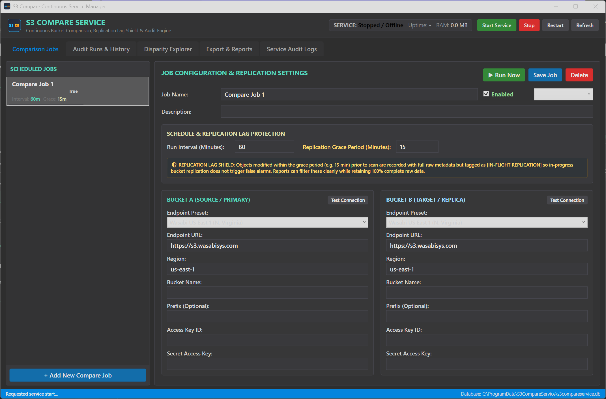

# S3CompareService

**S3CompareService** is a continuous S3 bucket comparison and disparity tracking system designed for enterprise-grade data synchronization auditing between Amazon S3 and S3-compatible cloud storage providers (such as Wasabi).

It runs continuous comparisons on automated schedules (interval or cron), captures bucket metadata snapshots at scan time, shields against transient replication lag false alarms, persists full raw history into a portable SQLite database, and automatically recovers from unexpected crashes or system restarts.



---

## Key Features

- **Continuous Comparison Engine**:
  - Resilient streaming scanner using continuation tokens without caching millions of objects in memory.
  - Supports **Listing Only** (metadata, size, and ETag comparison) and **Full Data** (64KB streaming byte-by-byte comparison).
  - Sequence gap detection for numeric filename series (e.g. `log_001.csv`, `log_003.csv`).
- **Replication Lag Grace Period (In-Flight Replication Shield)**:
  - Configurable window (e.g., 15 minutes) to ignore recent files from causing disparity alerts while replication jobs are actively copying data across regions.
  - Full raw data is **100% preserved** in the database with clipping and tag annotations (`[IN_FLIGHT_REPLICATION]` vs `[CONFIRMED_DISPARITY]`), allowing clean reporting while retaining complete audit trails.
- **Per-Job Alert Thresholds & Automated Notifications**:
  - Configurable alert thresholds per job: Max Confirmed Disparities, Max Missing in Bucket B (Target), Max Missing in Bucket A (Source), Max Size Mismatches, Max ETag/Hash Mismatches, and Max Sequence Gaps.
  - **Lag-Aware Alerting**: Disparity thresholds evaluate against confirmed differences only, automatically preventing false alarm pages when objects are within the active replication grace period.
  - Failure alerting immediately triggers on network drops, S3 permission errors, or service interruptions.
  - **Daily "All-Clear" Status Report & Heartbeat**:
    - Optional once-a-day digest with 24-hour activity metrics (completed scans, match rate %, zero confirmed disparities).
    - Can be scheduled for a specific hour of the day (e.g. 08:00 UTC).
    - Configurable to **only send if no alerts were triggered recently** (last 24 hours), confirming that the service is running normally and guarding buckets even when quiet.
- **Enterprise Notification Dispatchers**:
  - **SMTP / Email**: Rich HTML alert emails featuring job status, metrics summary, and confirmed disparity samples with host, port, SSL, authentication, sender, and recipient configuration.
  - **Azure-Based Alerting**:
    - **Azure Logic Apps / Webhook**: Seamless zero-code integration. Provide an HTTP Trigger URL to route structured JSON payloads directly to Microsoft Teams channels, Slack, SMS, or PagerDuty.
    - **Azure Application Insights**: Direct ingestion endpoint telemetry using connection strings to feed Azure Monitor dashboards and custom alerting rules.
  - Built-in test buttons in the UI and REST API (`/api/alerts/test-smtp`, `/api/alerts/test-azure-webhook`) for instant connectivity verification.
- **Crash Recovery & Ephemeral Data Resilience**:
  - Continuous incremental checkpointing to database every 5 seconds.
  - Service automatically detects interrupted scans upon startup, recovers state, and can resume from `LastEvaluatedKey`.
  - Windows Service configured with automated failure recovery actions (`restart/60000`).
- **Portable SQL Database**:
  - Self-contained SQLite database (`s3compareservice.db`) with Write-Ahead Logging (`WAL` mode) and busy-timeout handling.
  - Stores comparison jobs, execution runs, bucket metadata snapshots, difference records, and audit logs.
  - Zero external database server dependencies. Easily backed up, migrated, or inspected using standard tools.
  - **Bounded for long runs**: hourly retention of old runs, differences and audit logs (the newest completed run of a job is always kept), a cap on stored differences per run, a WAL size limit and incremental vacuum. See "Long-run operation" below.
- **Dual Architecture & Future-Proofing**:
  - Independent Background Worker (`S3CompareService.Worker`) capable of running as a native Windows Service or console process.
  - Embedded REST API (`http://localhost:5088/api`) exposing full health, job, run, and disparity data.
  - Modern Windows UI (`S3CompareService.UI`) built in WPF with a sleek dark theme matching S3Compare.
  - Directly prepared for any future Web UI dashboard consuming the same REST API.
- **Automated PowerShell Lifecycle Scripts**:
  - `install-service.ps1`: Registers Windows Service with auto-restart recovery and creates required folders. Optional `-EnableIdleMon` and `-SetIdleMonApiKey`.
  - `update-service.ps1`: Safely stops service, snapshots/backs up SQLite database, replaces binaries, and restarts. Backs up a changed `appsettings.json` and keeps IdleMon settings (see below).
  - `configure-idlemon.ps1`: Turns IdleMon reporting on or off and stores its API key for an existing install (`-Enable`, `-Disable`, `-SetApiKey`, `-DataDir`, `-Restart`).
  - `uninstall-service.ps1`: Safely stops and unregisters the service, optionally preserving data.
  - `status-service.ps1`: Checks service process status and queries API health.

---

## Solution Structure

```
S3CompareService/
├── S3CompareService.Core/        # Domain models, SQLite storage layer, S3 engine, and report exporters
├── S3CompareService.Worker/      # Hostable BackgroundService + REST API + Windows Service integration
├── S3CompareService.UI/          # Windows WPF UI manager (with Dark theme, Live Scan Monitor & Diff Explorer)
├── S3CompareService.Tests/       # Unit & integration test suite (Mock streams, Grace period, Recovery, SQLite)
├── scripts/                      # PowerShell scripts for service installation, update, removal, and status
├── icon.ico & icon.png           # Application icons matching S3Compare
└── README.md
```

---

## Getting Started

### Prerequisites

- Windows 10/11 or Windows Server 2019/2022/2025
- [.NET 9.0 SDK or Runtime](https://dotnet.microsoft.com/download/dotnet/9.0)

### Building the Solution

```powershell
# Clone the repository
git clone https://github.com/lesingerd/S3CompareService.git
cd S3CompareService

# Build all projects
dotnet build

# Run unit tests
dotnet test
```

---

## Service Installation & Management

Run PowerShell as an **Administrator**:

### 1. Install as a Windows Service
```powershell
.\scripts\install-service.ps1
```
*Creates `S3CompareService`, configures automatic crash restart actions (`sc failure reset= 86400 actions= restart/60000`), sets up the portable database at `C:\ProgramData\S3CompareService\s3compareservice.db`, and starts the service.*

### 2. Check Service Status & API Health
```powershell
.\scripts\status-service.ps1
```

### 3. Update Service Binaries (with Safe DB Backup)
```powershell
.\scripts\update-service.ps1
```
*Safely stops the service, creates a timestamped backup of the database (`s3compareservice.db.bak_YYYYMMDD_HHMMSS`), updates binaries, and restarts.*

### 4. Uninstall Service
```powershell
# Uninstalls service while preserving historical database
.\scripts\uninstall-service.ps1

# Or to remove data as well:
.\scripts\uninstall-service.ps1 -KeepData:$false
```

---

## Running Interactively (Console Mode)

For development, testing, or environments without Windows Service permissions:

```powershell
# Run the worker service in console mode
dotnet run --project S3CompareService.Worker

# In another terminal or desktop session, launch the Windows UI
dotnet run --project S3CompareService.UI
```

---

## Windows UI Application

The Windows UI (`S3CompareService.UI`) provides complete control:

1. **Dashboard**: Live status badge, system memory, active scan monitor with real-time speed (`obj/sec`), progress, and pause/resume/cancel controls.
2. **Comparison Jobs**: Add, edit, clone, and configure jobs:
   - S3 credentials for Bucket A and Bucket B (with Wasabi & AWS endpoint presets).
   - "Test Connection" buttons with instant connectivity and object counts feedback.
   - Schedule configuration (Interval minutes or Cron expression).
   - **Replication Lag Shield**: Set grace period in minutes (e.g. 15 minutes) to shield against in-flight replication disparities.
   - Sequence gap detection toggles.
3. **Audit Runs & History**: Timeline of historical scans, durations, objects evaluated, matched counts, confirmed disparities, and bucket metadata snapshots at scan time.
4. **Disparity Explorer**:
   - Filter by difference type (Missing in B, Missing in A, Size mismatch, ETag mismatch, Content mismatch, Sequence gap).
   - Filter by replication status:
     - `Confirmed Disparities Only` (hides in-flight replication lag)
     - `All Raw Differences` (complete unclipped dataset)
     - `In-Flight Lag Only`
   - Side-by-side inspection card comparing Bucket A vs Bucket B object metadata.
5. **Export & Reports**: Export difference sets to CSV or JSON with replication lag filters applied.
6. **Service Audit Logs**: Real-time log viewer for crash recoveries, service startups, and diagnostics.

---

## REST API Reference

The background service hosts a lightweight REST API on `http://localhost:5088`:

| Endpoint | Method | Description |
|---|---|---|
| `/api/status` | `GET` | Service status, uptime, RAM, active scans and live progress, and the notification queue and last deliveries |
| `/api/presets` | `GET` | Available Wasabi and AWS endpoint presets |
| `/api/test-connection` | `POST` | Tests S3 credentials and connectivity for a bucket |
| `/api/list-buckets` | `POST` | Discovers available buckets using provided credentials |
| `/api/jobs` | `GET` / `POST` | List all jobs or create a new comparison job |
| `/api/jobs/{id}` | `GET` / `PUT` / `DELETE` | Retrieve, update, or remove a comparison job |
| `/api/jobs/{id}/run` | `POST` | Trigger an immediate on-demand scan |
| `/api/runs` | `GET` | Retrieve scan execution history (supports `?jobId=` and `?count=`) |
| `/api/runs/{id}` | `GET` | Get run details and summary statistics |
| `/api/runs/{id}/snapshots` | `GET` | Get bucket metadata snapshots at scan time |
| `/api/runs/{id}/differences` | `GET` | Get paged differences (`?type=`, `?withinGracePeriod=`, `?searchKey=`) |
| `/api/runs/{id}/export/csv` | `GET` | Download CSV audit report (`?includeGracePeriod=true/false`) |
| `/api/runs/{id}/export/json` | `GET` | Download structured JSON audit dataset |
| `/api/runs/{id}/pause` | `POST` | Pause an active scan |
| `/api/runs/{id}/resume` | `POST` | Resume a paused scan |
| `/api/runs/{id}/cancel` | `POST` | Cancel an active scan |
| `/api/logs` | `GET` | Retrieve service audit and crash recovery logs |
| `/api/idlemon/status` | `GET` | IdleMon reporter status: enabled, last send time, queue length, spool files and size, last error, accepted and rejected counters, the settings file path and whether it exists, and whether an API key is set (never the key). Works when reporting is off. |

---

## Long-run operation: retention, limits and priority

The service is built to run for months without attention. These settings live in the `S3Compare` section of `appsettings.json`, or in `appsettings.Local.json` in the data directory (same precedence and restart rule as the IdleMon section below). Every number has a safe default; you only need to change them for unusual data volumes.

**Retention** (`S3Compare:Retention`). A background task (`RetentionService`) runs one hour after a start and then every hour. It never touches a running scan and never delays startup or crash recovery.

| Setting | Default | Meaning |
|---|---|---|
| `KeepRunsPerJob` | `500` | The newest N runs of each job are kept. 500 runs of an hourly job is about three weeks; of a daily job, more than a year. `0` = no limit by count. |
| `KeepDays` | `180` | Runs that started more than this many days ago are deleted. `0` = no limit by age. |
| `AuditLogDays` | `90` | Service audit log rows older than this are deleted. `0` = keep for ever. |
| `BatchSize` | `2000` | Rows deleted per transaction. The database is released between batches, so scans and the API keep their write access. |
| `AutoVacuumConvertMaxMegabytes` | `128` | See "Disk space" below. `0` = never convert. |

A run is deleted together with its differences and bucket snapshots. These are **never** deleted, whatever the settings say: the newest run of a job; the newest **completed** run of a job (IdleMon reporting reads it, even when later runs failed or it is older than `KeepDays`); any run that is Pending, Running, Paused or Interrupted (it can still be resumed); and any run that has a checkpoint. If the system clock is more than `KeepDays` (or `AuditLogDays`) ahead of the newest data, the age rules are skipped with a warning in the log, so a clock set years ahead cannot wipe the history; the count rule still applies.

**Disk space.** After each pass the WAL is checkpointed and truncated (it also has a 64 MB size limit), and free pages are returned to the file with `PRAGMA incremental_vacuum` in small steps. New databases are created with `auto_vacuum = INCREMENTAL`. A database created by an older version cannot switch modes without a full `VACUUM`, which locks writers while it runs. The service therefore converts an old database **once, only if the file is at most `AutoVacuumConvertMaxMegabytes` and no scan is running** (and there is room on disk for a temporary copy). A larger database is left alone and a warning in the log says so; deleted history then frees pages inside the file for reuse, but the file does not shrink. To convert a large database: stop the service, back up `s3compareservice.db`, run `sqlite3 s3compareservice.db "PRAGMA auto_vacuum = INCREMENTAL; VACUUM;"`, start the service. Schema version 3 also adds the `(JobId, StartTimeUtc)` run index and drops the redundant `JobId` index; this happens automatically at start.

**Differences per run** (`S3Compare:MaxRecordedDifferencesPerRun`, default `100000`). A bucket pair that diverges completely could otherwise store millions of rows in one run. Past the limit the scan continues and **every counter stays exact** (total, confirmed, in-flight, per type), but no more difference rows are stored. The run is flagged `DifferencesTruncated` (`differencesTruncated` in the API and in the JSON export), its `ScanWindowNotes` say so (the "Clipped Window" column in the UI), and the CSV export carries a `# TRUNCATED` header line. The paged difference list and the exports then hold the first N differences, not all of them. `0` = unlimited. 100,000 rows with their indexes are roughly 100 MB; that is far more than anyone reads in a UI, and enough to find the pattern of a large divergence.

**Load on the host and on S3** (these protect the monitored storage and the server; all are read-only against the buckets as before)

| Setting | Default | Meaning |
|---|---|---|
| `S3Compare:ProcessPriority` | `BelowNormal` | Priority class of the service process, set at start: `Idle`, `BelowNormal`, `Normal`, `AboveNormal` or `High`. `RealTime` is refused. The service then yields CPU to everything else on the server. |
| `S3Compare:MaxListRequestsPerSecond` | `20` | A token bucket (monotonic clock, burst of one second's worth) that paces every S3 request a scan sends: list pages, and in Full Data mode the object reads. It applies per scan and per bucket side. `0` = unlimited. |

Why 20: one list request returns 1,000 keys, so 20 requests per second is 20,000 keys per second per side. A scan makes its list requests one after another and normally manages 5 to 10 per second against a public cloud endpoint, so the default does not slow a normal scan. It only matters when the endpoint answers very quickly (an on-premises S3 on a fast network), where an unthrottled scan would hammer it. Lower it (for example `2`) for a fragile on-premises object store; a 100-million-object bucket then takes about 14 hours instead of the 3 to 6 hours it takes at the usual 5 to 10 requests per second.

Scan threads do not use Windows background I/O mode (`THREAD_MODE_BACKGROUND_BEGIN`): scans are async tasks that move between thread pool threads, so a per-thread mode would not be reliable. The below-normal process priority and the rate limit do the job instead.

**Time and clocks.** Waits, "next due" checks and stall detection use the monotonic clock, so setting the wall clock back or forward cannot stall or burst them: the IdleMon heartbeat, collection and sender backoff, the scheduler loop (it wakes every 10 seconds) and the retention task. Job schedules (interval after the last start, cron) are wall-clock UTC because they are calendar times. A job whose recorded last run is more than five minutes in the future (the clock was set back) is treated as due, rather than waiting for the clock to catch up.

**Notifications** (`S3Compare:Notifications`). Alerts and daily digests are not sent by the scheduler loop or the scan. They go into a bounded queue (100 items) and a separate task, `NotificationDispatcher`, delivers them. The scheduler and the scans only add an item and carry on, so a slow or dead SMTP server cannot delay a schedule evaluation, a scan or the IdleMon heartbeat.

| Setting | Default | Meaning |
|---|---|---|
| `S3Compare:Notifications:DeliveryTimeoutSeconds` | `30` | The longest one delivery (SMTP, webhook or App Insights) may take. After that the attempt is abandoned even if the channel ignores cancellation (`SmtpClient` often does), and counted as a failure. Values below 1 mean the default. |

- **Channels are independent.** For one alert the SMTP, webhook and App Insights deliveries run side by side, each with its own timeout. A dead mail server does not delay the webhook.
- **Timestamps only after a success.** `LastAlertSentUtc` and `LastDailyDigestSentUtc` are written only after a channel delivered, as before. The digest rules are unchanged (hour, once per day, "only if no recent alerts"); the dispatcher checks them again just before it sends. A failed digest is queued again after about 5 minutes, not every 10 seconds.
- **At most one digest per job and UTC day**, even if the scheduler queues it twice.
- **Full queue.** The oldest daily digest (or periodic "all clear" notice) is dropped and counted. Failure and threshold alerts are never dropped.
- **Nothing can stop the host.** Every item is handled in its own try/catch; an exception is logged and counted. Items still queued at shutdown are not sent (a digest is queued again at the next start if it was not sent).
- **Status.** `GET /api/status` has a `Notifications` block: `Queued`, `Dropped`, `Delivered`, `Failed`, `LastSuccessUtc`, `LastFailureUtc`, `LastError` (shortened), `ConsecutiveFailures` and `FailingSinceUtc`. This is kept in memory and resets at a restart. It does not feed the IdleMon heartbeat yet.
- **Test buttons** (test e-mail, test webhook) in the UI still run in the request, with the same timeout.

```json
{
  "S3Compare": {
    "ProcessPriority": "BelowNormal",
    "MaxListRequestsPerSecond": 20,
    "MaxRecordedDifferencesPerRun": 100000,
    "Retention": { "KeepRunsPerJob": 500, "KeepDays": 180, "AuditLogDays": 90 },
    "Notifications": { "DeliveryTimeoutSeconds": 30 }
  }
}
```

---

## IdleMon integration

S3CompareService can report to [IdleMon](https://github.com/lesingerd/IdleMon), a central collector for alerts, events and metrics from in-house tools on Windows servers. The reporter is **off by default**: with `IdleMon:Enabled` set to `false` nothing is sent and no file is written.

When enabled, the Worker sends to the IdleMon agent **on the same machine only** (`http://127.0.0.1:47100`; any other host is refused). It uses ingest contract v1 and never blocks or affects a scan: messages are queued in memory, sent in the background, and spooled to disk (JSON Lines, oldest first on replay) when the agent is down.

**What it sends**

| Kind | Content |
|---|---|
| Metrics (every `MetricsIntervalSeconds`) | Per job: age of the last completed run, consecutive failures, and the newest completed run's counts (confirmed and in-flight disparities, missing in A/B, size, ETag and content mismatches, sequence gaps, objects compared, match rate, duration, bytes read), plus live progress of a running scan. Service level: enabled, failing, overdue and disparity job counts, active scans. |
| Alerts | `run-failed`, `disparities` (the job's own thresholds), `overdue` and `scan-stuck`, per job. They fire and resolve on state changes and are refreshed every metrics interval. Disabling or deleting a job resolves its alerts. |
| Events | Run completed, failed or cancelled; crash recovery; job created, updated, deleted, enabled, disabled; service start. |
| Snapshots | `s3c.jobs` (one row per job); `s3c.run.top_disparities` only when `IncludeObjectKeys` is `true`. |
| Heartbeat | Every `HeartbeatIntervalSeconds`, on its own task from in-memory state only (a blocked database or disk cannot delay it); `degraded` when the database cannot be read, the scheduler has stopped evaluating, or a scan is stuck; `stopping` on a clean shutdown. |

The full list of names, units and rules is in the [message catalog](https://github.com/lesingerd/IdleMon/blob/main/docs/integrations/s3compare-catalog.md).

**Where the settings live (they survive updates)**

The `IdleMon` section is read from `appsettings.json` in the install folder and then from an optional override file, **`appsettings.Local.json` in the data directory** (`C:\ProgramData\S3CompareService` by default, or the `--S3Compare:DataDirectory` the service was installed with). The override file is not part of the published output, so `update-service.ps1` never overwrites it; a file you edit in the install folder *is* overwritten by an update. Order of precedence, lowest to highest: `appsettings.json`, `appsettings.Local.json`, environment variables, command-line arguments. The file is read **once at start-up**; restart the service after editing it.

`update-service.ps1` compares the installed `appsettings.json` with the new one. If they differ it saves the old one as `appsettings.json.bak_<timestamp>` and prints a warning. If the old file had `IdleMon.Enabled` set to `true` and no `appsettings.Local.json` exists yet, the old `IdleMon` section is moved into a new `appsettings.Local.json` automatically.

**Enable it** (elevated PowerShell, existing install, no reinstall):

```powershell
.\scripts\configure-idlemon.ps1 -Enable -SetApiKey -Restart
```

`-SetApiKey` asks for the key with hidden input and stores it as `IDLEMON_APIKEY` in the service's own environment (the `Environment` value under `HKLM:\SYSTEM\CurrentControlSet\Services\S3CompareService`). The key is never a parameter, never written to a file and never printed. `-Disable` turns reporting off again. On a fresh install, `install-service.ps1 -EnableIdleMon -SetIdleMonApiKey` does the same; a reinstall keeps the service environment. A minimal override file looks like this:

```json
{
  "IdleMon": {
    "Enabled": true,
    "Instance": "contoso-s3"
  }
}
```

**The IdleMon card in the UI.** The main window shows a read-only IdleMon card under the header, refreshed with the service status. Badge: `Off` (grey), `Dry run` (blue, with the output file), `Sending` (green: last send within two heartbeat intervals, no error), `Agent unreachable - spooling` (amber: a last error or files in the spool; shows spool size and file count), `No recent send` (amber: enabled but nothing sent recently), `Config problem` (red, with the reason) and `Unknown` (the service is offline). It also shows the last send (relative and UTC), accepted, rejected and dropped counters, queue length, whether an API key is set, and the settings file path. Settings cannot be edited from the UI; that keeps secrets and admin rights out of it.

**Settings** (`IdleMon` section)

| Setting | Default | Meaning |
|---|---|---|
| `Enabled` | `false` | Turns the reporter on. |
| `AgentUrl` | `http://127.0.0.1:47100` | The local IdleMon agent. Must be a loopback address. |
| `ApiKeyEnv` | `IDLEMON_APIKEY` | Name of the environment variable that holds the key (sent as `X-IdleMon-ApiKey`). The key is never stored in configuration. |
| `Instance` | `default` | Distinguishes several copies of the service on one host. |
| `HeartbeatIntervalSeconds` | `60` | |
| `MetricsIntervalSeconds` | `300` | Also declared to IdleMon as the data interval. |
| `SpoolDirectory` | `<data directory>\idlemon-spool` | Where unsent messages wait. |
| `SpoolMaxMegabytes` | `50` | When full, old info events go first, then other non-alert messages, then older refreshes of alerts (only the latest firing or resolved message per alert key is kept). Error events stay until the hard ceiling of twice this size; the latest state of an alert is never dropped. |
| `DryRunFile` | empty | When set, batches are written to this file as JSON Lines instead of being sent. |
| `IncludeBucketNames` | `true` | When `false`, `A` and `B` are sent instead of the bucket names. |
| `IncludeObjectKeys` | `false` | Send the top-disparities snapshot, which contains object keys. |
| `OverdueMultiplier` | `2` | The `overdue` alert fires after this many cadences (plus 15 minutes) without a completed run. |
| `StaleResultMultiplier` | `3` | A job's last result keeps being re-sent for this many cadences (at least 10 minutes); after that IdleMon shows it as stale. |
| `StuckScanMinutes` | `15` | A running scan whose object count has not changed for this long raises `scan-stuck`. |

For example, to try it without an agent, run the Worker with `--IdleMon:Enabled=true --IdleMon:DryRunFile=C:\Temp\idlemon.jsonl`. To send for real, use `scripts\configure-idlemon.ps1 -Enable -SetApiKey -Restart` as above. `GET /api/idlemon/status` and `scripts\status-service.ps1` show whether it is sending.

**Never sent:** credentials, access keys, secret keys, webhook URLs, SMTP settings, or object contents. Object keys are sent only when `IncludeObjectKeys` is `true`; bucket names are sent unless `IncludeBucketNames` is `false`. Job names are always sent (for example `contoso-archive-vs-wasabi`).

Nothing about this integration has been verified on a production server yet. It has been tested with unit tests, a dry run, and a local IdleMon agent on a development machine, using fake jobs and including a 40-second agent outage that was spooled and replayed.

**Spool behaviour.** The spool keeps an in-memory index, so its size and backlog age (the heartbeat tag `backlogSeconds`) cost no disk access. A spool file that cannot be read (access denied, locked by a scanner) is skipped and retried every 30 seconds, so newer files and fresh messages are still sent; after 24 hours of failing it is renamed to `.bad` and counted as dropped. A spool file is deleted only after IdleMon accepted its contents.

Known limitation: firing alerts are tracked in memory. If a job is disabled or deleted while the service is stopped, alerts already sent for it are not resolved by the service; resolve them in IdleMon.

---

## License

MIT License. Designed and developed as an automated continuous audit service based on the S3Compare architecture.
