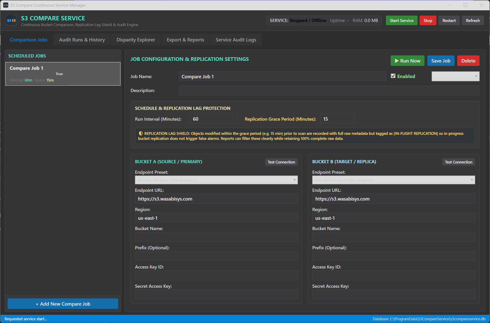

# S3CompareService

**S3CompareService** is a continuous S3 bucket comparison and disparity tracking system designed for enterprise-grade data synchronization auditing between Amazon S3 and S3-compatible cloud storage providers (such as Wasabi).

It runs continuous comparisons on automated schedules (interval or cron), captures bucket metadata snapshots at scan time, shields against transient replication lag false alarms, persists full raw history into a portable SQLite database, and automatically recovers from unexpected crashes or system restarts.



---

## Key Features

- **Continuous Comparison Engine**:
  - Resilient streaming scanner using continuation tokens without caching millions of objects in memory.
  - **Parallel scanning**: the keyspace is split into key ranges that are compared at the same time, and every bucket listing fetches its next pages in the background, with throttles for list requests, compared objects and content checks (see "Parallel scanning and throughput" below).
  - Supports **Listing Only** (metadata, size, and ETag comparison) and **Full Data** (64KB streaming byte-by-byte comparison).
  - Sequence gap detection for numeric filename series (e.g. `log_001.csv`, `log_003.csv`).
- **Replication Lag Grace Period (In-Flight Replication Shield)**:
  - Configurable window (e.g., 15 minutes) to ignore recent files from causing disparity alerts while replication jobs are actively copying data across regions.
  - Full raw data is **100% preserved** in the database with clipping and tag annotations (`[IN_FLIGHT_REPLICATION]` vs `[CONFIRMED_DISPARITY]`), allowing clean reporting while retaining complete audit trails.
- **Per-Job Alert Thresholds & Automated Notifications**:
  - Configurable alert thresholds per job: Max Confirmed Disparities, Max Missing in Bucket B (Target), Max Missing in Bucket A (Source), Max Size Mismatches, Max ETag/Hash Mismatches, and Max Sequence Gaps.
  - **Lag-Aware Alerting**: Disparity thresholds evaluate against confirmed differences only, automatically preventing false alarm pages when objects are within the active replication grace period.
  - Failure alerting immediately triggers on network drops, S3 permission errors, or service interruptions.
  - **Daily "All-Clear" Status Report & Heartbeat**:
    - Optional once-a-day digest with 24-hour activity metrics (completed scans, match rate %, zero confirmed disparities).
    - Can be scheduled for a specific hour of the day (e.g. 08:00 UTC).
    - Configurable to **only send if no alerts were triggered recently** (last 24 hours), confirming that the service is running normally and guarding buckets even when quiet.
- **Enterprise Notification Dispatchers**:
  - **SMTP / Email**: Rich HTML alert emails featuring job status, metrics summary, and confirmed disparity samples with host, port, SSL, authentication, sender, and recipient configuration.
  - **Azure-Based Alerting**:
    - **Azure Logic Apps / Webhook**: Seamless zero-code integration. Provide an HTTP Trigger URL to route structured JSON payloads directly to Microsoft Teams channels, Slack, SMS, or PagerDuty.
    - **Azure Application Insights**: Direct ingestion endpoint telemetry using connection strings to feed Azure Monitor dashboards and custom alerting rules.
  - Built-in test buttons in the UI and REST API (`/api/alerts/test-smtp`, `/api/alerts/test-azure-webhook`) for instant connectivity verification.
- **Crash Recovery & Ephemeral Data Resilience**:
  - Continuous incremental checkpointing to database every 5 seconds.
  - Service automatically detects interrupted scans upon startup, recovers state, and resumes each key range from its last checkpointed key (older single-key checkpoints still resume).
  - Windows Service configured with automated failure recovery actions (`restart/60000`).
- **Portable SQL Database**:
  - Self-contained SQLite database (`s3compareservice.db`) with Write-Ahead Logging (`WAL` mode) and busy-timeout handling.
  - Stores comparison jobs, execution runs, bucket metadata snapshots, difference records, and audit logs.
  - Zero external database server dependencies. Easily backed up, migrated, or inspected using standard tools.
  - **Bounded for long runs**: hourly retention of old runs, differences and audit logs (the newest completed run of a job is always kept), a cap on stored differences per run, a WAL size limit and incremental vacuum. See "Long-run operation" below.
- **Dual Architecture & Future-Proofing**:
  - Independent Background Worker (`S3CompareService.Worker`) capable of running as a native Windows Service or console process.
  - Embedded REST API (`http://localhost:5088/api`) exposing full health, job, run, and disparity data.
  - Modern Windows UI (`S3CompareService.UI`) built in WPF with a sleek dark theme matching S3Compare.
  - Directly prepared for any future Web UI dashboard consuming the same REST API.
- **Automated PowerShell Lifecycle Scripts**:
  - `install-service.ps1`: Registers Windows Service with auto-restart recovery and creates required folders. Optional `-EnableIdleMon` and `-SetIdleMonApiKey`.
  - `update-service.ps1`: Safely stops service, snapshots/backs up SQLite database, replaces binaries, and restarts. Backs up a changed `appsettings.json` and keeps IdleMon settings (see below).
  - `configure-idlemon.ps1`: Turns IdleMon reporting on or off and stores its API key for an existing install (`-Enable`, `-Disable`, `-SetApiKey`, `-DataDir`, `-Restart`).
  - `uninstall-service.ps1`: Safely stops and unregisters the service, optionally preserving data.
  - `status-service.ps1`: Checks service process status and queries API health.

---

## Solution Structure

```
S3CompareService/
├── S3CompareService.Core/        # Domain models, SQLite storage layer, S3 engine, and report exporters
├── S3CompareService.Worker/      # Hostable BackgroundService + REST API + Windows Service integration
├── S3CompareService.UI/          # Windows WPF UI manager (with Dark theme, Live Scan Monitor & Diff Explorer)
├── S3CompareService.Tests/       # Unit & integration test suite (Mock streams, Grace period, Recovery, SQLite)
├── scripts/                      # PowerShell scripts for service installation, update, removal, and status
├── icon.ico & icon.png           # Application icons matching S3Compare
└── README.md
```

---

## Getting Started

### Prerequisites

- Windows 10/11 or Windows Server 2019/2022/2025
- [.NET 9.0 SDK or Runtime](https://dotnet.microsoft.com/download/dotnet/9.0)

### Building the Solution

```powershell
# Clone the repository
git clone https://github.com/lesingerd/S3CompareService.git
cd S3CompareService

# Build all projects
dotnet build

# Run unit tests
dotnet test
```

---

## Service Installation & Management

Run PowerShell as an **Administrator**:

### 1. Install as a Windows Service
```powershell
.\scripts\install-service.ps1
```
*Creates `S3CompareService`, configures automatic crash restart actions (`sc failure reset= 86400 actions= restart/60000`), sets up the portable database at `C:\ProgramData\S3CompareService\s3compareservice.db`, and starts the service.*

### 2. Check Service Status & API Health
```powershell
.\scripts\status-service.ps1
```

### 3. Update Service Binaries (with Safe DB Backup)
```powershell
.\scripts\update-service.ps1
```
*Safely stops the service, creates a timestamped backup of the database (`s3compareservice.db.bak_YYYYMMDD_HHMMSS`), updates binaries, and restarts.*

### 4. Uninstall Service
```powershell
# Uninstalls service while preserving historical database
.\scripts\uninstall-service.ps1

# Or to remove data as well:
.\scripts\uninstall-service.ps1 -KeepData:$false
```

---

## Running Interactively (Console Mode)

For development, testing, or environments without Windows Service permissions:

```powershell
# Run the worker service in console mode
dotnet run --project S3CompareService.Worker

# In another terminal or desktop session, launch the Windows UI
dotnet run --project S3CompareService.UI
```

---

## Windows UI Application

The Windows UI (`S3CompareService.UI`) provides complete control:

1. **Dashboard**: Live status badge, system memory, active scan monitor with real-time speed (`obj/sec`), objects read per bucket, key ranges done / total, progress, and pause/resume/cancel controls.
2. **Comparison Jobs**: Add, edit, clone, and configure jobs:
   - S3 credentials for Bucket A and Bucket B (with Wasabi & AWS endpoint presets).
   - "Test Connection" buttons with instant connectivity and object counts feedback.
   - Schedule configuration (Interval minutes or Cron expression).
   - **Replication Lag Shield**: Set grace period in minutes (e.g. 15 minutes) to shield against in-flight replication disparities.
   - Sequence gap detection toggles.
   - **Performance / Throttling**: per-job overrides of the parallel-scan settings (empty = service default), with tooltips.
3. **Audit Runs & History**: Timeline of historical scans, durations, objects evaluated, matched counts, confirmed disparities, and bucket metadata snapshots at scan time.
4. **Disparity Explorer**:
   - Filter by difference type (Missing in B, Missing in A, Size mismatch, ETag mismatch, Content mismatch, Sequence gap).
   - Filter by replication status:
     - `Confirmed Disparities Only` (hides in-flight replication lag)
     - `All Raw Differences` (complete unclipped dataset)
     - `In-Flight Lag Only`
   - Side-by-side inspection card comparing Bucket A vs Bucket B object metadata.
5. **Export & Reports**: Export difference sets to CSV or JSON with replication lag filters applied.
6. **Service Audit Logs**: Real-time log viewer for crash recoveries, service startups, and diagnostics.

---

## REST API Reference

The background service hosts a lightweight REST API on `http://localhost:5088`:

| Endpoint | Method | Description |
|---|---|---|
| `/api/status` | `GET` | Service status, uptime, RAM, active scans and live progress, and the notification queue and last deliveries |
| `/api/presets` | `GET` | Available Wasabi and AWS endpoint presets |
| `/api/test-connection` | `POST` | Tests S3 credentials and connectivity for a bucket |
| `/api/list-buckets` | `POST` | Discovers available buckets using provided credentials |
| `/api/jobs` | `GET` / `POST` | List all jobs or create a new comparison job |
| `/api/jobs/{id}` | `GET` / `PUT` / `DELETE` | Retrieve, update, or remove a comparison job |
| `/api/jobs/{id}/run` | `POST` | Trigger an immediate on-demand scan |
| `/api/runs` | `GET` | Retrieve scan execution history (supports `?jobId=` and `?count=`) |
| `/api/runs/{id}` | `GET` | Get run details and summary statistics |
| `/api/runs/{id}/snapshots` | `GET` | Get bucket metadata snapshots at scan time |
| `/api/runs/{id}/differences` | `GET` | Get paged differences (`?type=`, `?withinGracePeriod=`, `?searchKey=`) |
| `/api/runs/{id}/export/csv` | `GET` | Download CSV audit report (`?includeGracePeriod=true/false`) |
| `/api/runs/{id}/export/json` | `GET` | Download structured JSON audit dataset |
| `/api/runs/{id}/pause` | `POST` | Pause an active scan |
| `/api/runs/{id}/resume` | `POST` | Resume a paused scan |
| `/api/runs/{id}/cancel` | `POST` | Cancel an active scan |
| `/api/runs/{id}/diagnostics` | `GET` | Live diagnostics of an active scan: phase, planner, per-bucket request stats, partition table (at most 256 rows), in-flight operations |
| `/api/settings/scan-defaults` | `GET` | The effective service-wide scan settings (what empty per-job overrides use) |
| `/api/logs` | `GET` | Retrieve service audit and crash recovery logs |
| `/api/idlemon/status` | `GET` | IdleMon reporter status: enabled, last send time, queue length, spool files and size, last error, accepted and rejected counters, the settings file path and whether it exists, and whether an API key is set (never the key). Works when reporting is off. |

---

## Long-run operation: retention, limits and priority

The service is built to run for months without attention. These settings live in the `S3Compare` section of `appsettings.json`, or in `appsettings.Local.json` in the data directory (same precedence and restart rule as the IdleMon section below). Every number has a safe default; you only need to change them for unusual data volumes.

**Checking that the settings were read.** At every start the service writes to the audit log (Service Audit Logs tab, category `Settings`):
- whether `appsettings.Local.json` was found, and if so its path, size, time and every value it sets (`S3Compare:MaxRecordedDifferencesPerRun = 0; ...`; passwords, keys and tokens are shown as `********`);
- a WARN for each value that was out of range or unreadable, with the value used instead;
- the effective scan defaults (`Effective scan defaults ...: MaxRecordedDifferencesPerRun = unlimited; MaxParallelPartitions = 8; ...`).

A local file that is not valid JSON no longer stops the service: it is ignored, and an ERROR line (`FAILED: local settings file ... could not be read and was IGNORED (...)`) says why. Every scan's `Starting scan run ...` line also shows its stored-differences limit, and whether it comes from the job.

**Retention** (`S3Compare:Retention`). A background task (`RetentionService`) runs one hour after a start and then every hour. It never touches a running scan and never delays startup or crash recovery.

| Setting | Default | Meaning |
|---|---|---|
| `KeepRunsPerJob` | `500` | The newest N runs of each job are kept. 500 runs of an hourly job is about three weeks; of a daily job, more than a year. `0` = no limit by count. |
| `KeepDays` | `180` | Runs that started more than this many days ago are deleted. `0` = no limit by age. |
| `AuditLogDays` | `90` | Service audit log rows older than this are deleted. `0` = keep for ever. |
| `BatchSize` | `2000` | Rows deleted per transaction. The database is released between batches, so scans and the API keep their write access. |
| `AutoVacuumConvertMaxMegabytes` | `128` | See "Disk space" below. `0` = never convert. |

A run is deleted together with its differences and bucket snapshots. These are **never** deleted, whatever the settings say: the newest run of a job; the newest **completed** run of a job (IdleMon reporting reads it, even when later runs failed or it is older than `KeepDays`); any run that is Pending, Running, Paused or Interrupted (it can still be resumed); and any run that has a checkpoint. If the system clock is more than `KeepDays` (or `AuditLogDays`) ahead of the newest data, the age rules are skipped with a warning in the log, so a clock set years ahead cannot wipe the history; the count rule still applies.

**Disk space.** After each pass the WAL is checkpointed and truncated (it also has a 64 MB size limit), and free pages are returned to the file with `PRAGMA incremental_vacuum` in small steps. New databases are created with `auto_vacuum = INCREMENTAL`. A database created by an older version cannot switch modes without a full `VACUUM`, which locks writers while it runs. The service therefore converts an old database **once, only if the file is at most `AutoVacuumConvertMaxMegabytes` and no scan is running** (and there is room on disk for a temporary copy). A larger database is left alone and a warning in the log says so; deleted history then frees pages inside the file for reuse, but the file does not shrink. To convert a large database: stop the service, back up `s3compareservice.db`, run `sqlite3 s3compareservice.db "PRAGMA auto_vacuum = INCREMENTAL; VACUUM;"`, start the service. Schema version 3 also adds the `(JobId, StartTimeUtc)` run index and drops the redundant `JobId` index; schema version 4 adds the checkpoint partition plan (`Checkpoints.PartitionPlanJson`) the per-job throughput overrides (`Jobs.Performance_Json`) and the Full Data read-error counter (`ScanRuns.ContentCheckErrorCount`). Both happen automatically at start.

**Differences per run** (`S3Compare:MaxRecordedDifferencesPerRun`, default `100000`). A bucket pair that diverges completely could otherwise store millions of rows in one run. Past the limit the scan continues and **every counter stays exact** (total, confirmed, in-flight, per type), but no more difference rows are stored. The run is flagged `DifferencesTruncated` (`differencesTruncated` in the API and in the JSON export), its `ScanWindowNotes` say so (the "Clipped Window" column in the UI), and the CSV export carries a `# TRUNCATED` header line. The paged difference list and the exports then hold the first N differences, not all of them (with parallel scanning, the first ones found, not the first by key). The Disparity Explorer then shows an amber banner (`LIMIT REACHED: 100,000 of 1,000,000 differences were stored for this run ...`), and exporting such a run asks first and says so again when it is done. `0` = unlimited. The limit can also be set per job (job editor, Performance / Throttling, "Max Stored Differences (per run)"; API `performance.maxRecordedDifferencesPerRun`, 0 to 1,000,000,000). Rows that were not stored cannot be recovered: raise the limit and run a new scan. 100,000 rows with their indexes are roughly 100 MB; that is far more than anyone reads in a UI, and enough to find the pattern of a large divergence.

**Load on the host and on S3** (these protect the monitored storage and the server; all are read-only against the buckets as before)

| Setting | Default | Meaning |
|---|---|---|
| `S3Compare:ProcessPriority` | `BelowNormal` | Priority class of the service process, set at start: `Idle`, `BelowNormal`, `Normal`, `AboveNormal` or `High`. `RealTime` is refused. The service then yields CPU to everything else on the server. |
| `S3Compare:MaxListRequestsPerSecond` | `20` | A token bucket (monotonic clock, burst of one second's worth) that paces every S3 request a scan sends: list pages, and in Full Data mode the object reads. It applies per scan and per bucket side, and is **shared** by all partitions of the scan, the partition planner and the Full Data object reads, so raising `MaxParallelPartitions` never raises the request rate past this limit. `0` = unlimited. Can be overridden per job. |

Why 20: one list request returns 1,000 keys, so 20 requests per second is 20,000 keys per second per side. One listing stream (one partition) normally manages 5 to 10 requests per second against a public cloud endpoint; with the default 8 partitions a scan reaches the limit, so the limit, not the latency, then sets the speed (about 20,000 objects per second, a 100-million-object bucket in about 1.5 hours). Raise it if the endpoint and your request budget allow (see "Parallel scanning and throughput" below). Lower it (for example `2`) for a fragile on-premises object store; a 100-million-object bucket then takes about 14 hours.

Scan threads do not use Windows background I/O mode (`THREAD_MODE_BACKGROUND_BEGIN`): scans are async tasks that move between thread pool threads, so a per-thread mode would not be reliable. The below-normal process priority and the rate limit do the job instead.

**Time and clocks.** Waits, "next due" checks and stall detection use the monotonic clock, so setting the wall clock back or forward cannot stall or burst them: the IdleMon heartbeat, collection and sender backoff, the scheduler loop (it wakes every 10 seconds) and the retention task. Job schedules (interval after the last start, cron) are wall-clock UTC because they are calendar times. A job whose recorded last run is more than five minutes in the future (the clock was set back) is treated as due, rather than waiting for the clock to catch up.

**Notifications** (`S3Compare:Notifications`). Alerts and daily digests are not sent by the scheduler loop or the scan. They go into a bounded queue (100 items) and a separate task, `NotificationDispatcher`, delivers them. The scheduler and the scans only add an item and carry on, so a slow or dead SMTP server cannot delay a schedule evaluation, a scan or the IdleMon heartbeat.

| Setting | Default | Meaning |
|---|---|---|
| `S3Compare:Notifications:DeliveryTimeoutSeconds` | `30` | The longest one delivery (SMTP, webhook or App Insights) may take. After that the attempt is abandoned even if the channel ignores cancellation (`SmtpClient` often does), and counted as a failure. Values below 1 mean the default. |

- **Channels are independent.** For one alert the SMTP, webhook and App Insights deliveries run side by side, each with its own timeout. A dead mail server does not delay the webhook.
- **Timestamps only after a success.** `LastAlertSentUtc` and `LastDailyDigestSentUtc` are written only after a channel delivered, as before. The digest rules are unchanged (hour, once per day, "only if no recent alerts"); the dispatcher checks them again just before it sends. A failed digest is queued again after about 5 minutes, not every 10 seconds.
- **At most one digest per job and UTC day**, even if the scheduler queues it twice.
- **Full queue.** The oldest daily digest (or periodic "all clear" notice) is dropped and counted. Failure and threshold alerts are never dropped.
- **Nothing can stop the host.** Every item is handled in its own try/catch; an exception is logged and counted. Items still queued at shutdown are not sent (a digest is queued again at the next start if it was not sent).
- **Status.** `GET /api/status` has a `Notifications` block: `Queued`, `Dropped`, `Delivered`, `Failed`, `LastSuccessUtc`, `LastFailureUtc`, `LastError` (shortened), `ConsecutiveFailures` and `FailingSinceUtc`. This is kept in memory and resets at a restart. It does not feed the IdleMon heartbeat yet.
- **Test buttons** (test e-mail, test webhook) in the UI still run in the request, with the same timeout.

```json
{
  "S3Compare": {
    "ProcessPriority": "BelowNormal",
    "MaxListRequestsPerSecond": 20,
    "MaxParallelPartitions": 8,
    "PrefetchPages": 2,
    "MaxObjectsPerSecond": 0,
    "MaxConcurrentContentChecks": 8,
    "MaxDiscoveryRequests": 500,
    "MaxPlanningSeconds": 60,
    "MaxRecordedDifferencesPerRun": 100000,
    "Retention": { "KeepRunsPerJob": 500, "KeepDays": 180, "AuditLogDays": 90 },
    "Notifications": { "DeliveryTimeoutSeconds": 30 }
  }
}
```

---

## Parallel scanning and throughput

A scan compares two sorted listings (merge join). A single listing stream is limited by the round trip of one ListObjectsV2 request (1,000 keys per page): at 100 to 200 ms per page that is 5,000 to 10,000 objects per second, about 3 to 6 hours for 100 million objects. Two mechanisms remove that limit.

**1. Prefetch.** Every listing (bucket A and bucket B, for every key range) has a background producer that requests the next pages while the comparison works on the current one, and puts them in a bounded queue of `PrefetchPages` pages. The A and B listings run at the same time. Memory stays bounded: at most `PrefetchPages + 1` pages (about 1,000 objects each) per listing.

**2. Key-range partitioning.** Before the scan, a planner splits the keyspace into ranges that tile it exactly (no gaps, no overlap), using both buckets:

- **Delimiter discovery**: lists the "folders" (`Delimiter = "/"`) level by level, down to `MaxDiscoveryDepth` levels. It keeps descending after it has enough boundaries, as long as the next level can be listed completely within half of the remaining budget: the ranges are spaced evenly over the folders found, so a folder with thousands of subfolders must contribute them. (Stopping early used to put most of a bucket into one range when a few near-empty top folders each held one big subfolder.)
- **Probe fallback** for flat keyspaces (no folders) or too few folders, inside the deepest folder level found: first it skips the part of the names that all keys share (`file_00001.dat`, `IMG_0001.jpg`, `logs-2024-...` are split where they differ, not at `f`), then single-key requests (`MaxKeys = 1`, `StartAfter = prefix + probe`) at evenly spaced characters find real keys to use as boundaries, coarse to fine over up to 4 rounds. The budget is split evenly over the rounds, the folders and the two buckets, so a small budget still spreads its probes over the whole alphabet.
- Both stop at `MaxDiscoveryRequests` requests. If the planner fails or finds nothing, the scan runs as one range, exactly as before.

The plan has about `MaxParallelPartitions × PartitionOversubscription` ranges. `MaxParallelPartitions` workers take ranges from a queue. Each range is a separate merge join over the two listings with `StartAfter` at its lower bound; it stops at its upper bound. One database writer stores differences in batches; the statistics, the difference cap (`MaxRecordedDifferencesPerRun`), the events, pause and cancel are shared by all workers.

**3. Work stealing (range splitting).** A plan can still be uneven: folder names say nothing about how many objects they hold. When a worker finds the queue empty while other ranges are still running, it splits one of them and takes the second half:

- It picks the running range left alone longest (running, or last split, at least 5 s ago).
- It lists the subfolders still ahead of that range's worker (`Delimiter = "/"`, `StartAfter` = the worker's current key, both buckets, from the top folder down) and cuts at the middle subfolder of the shallowest folder with at least two ahead (paging up to 5 pages). Flat keyspaces use a small probe plan instead (at most 40 requests).
- The cut is applied only if the worker has not reached it yet: the running range then ends at the cut and the new range starts after it. Both are part of the plan and the checkpoint, so a resumed scan keeps them.
- An attempt costs a few list requests (within the rate limit). If it finds no cut it backs off (10 s, doubling up to 2 min) and gives up on that range after 6 tries.
- All `MaxParallelPartitions` workers start even when fewer ranges are left (for example on resume), so the idle ones can split.
- The Scan Diagnostics tab shows `PARTITIONS ... · N split by idle workers`, the banner `· N split`, and every split is logged (`Split key range #i: an idle worker took (...]`). `S3Compare:EnableRangeSplitting = false` turns it off.

| Setting | Default | Range | Meaning |
|---|---|---|---|
| `S3Compare:MaxParallelPartitions` | `8` | 1 to 256 | Key ranges compared at the same time. `1` = one listing per bucket (still with prefetch). |
| `S3Compare:PrefetchPages` | `2` | 1 to 64 | Pages each listing fetches ahead. Lowered automatically so that `MaxParallelPartitions × (PrefetchPages + 1)` stays at most 512 pages per bucket (memory, see below). |
| `S3Compare:MaxListRequestsPerSecond` | `20` | 0 to 100000 | See above; shared per bucket by everything the scan sends. `0` = unlimited. |
| `S3Compare:MaxObjectsPerSecond` | `0` | 0 to 100000000 | Limits compared **keys** per second, all partitions together. A key present in both buckets counts once, like a key present in only one, so it is the same unit as `ObjectsCompared` and the `obj/sec` speed. `0` = unlimited. |
| `S3Compare:MaxConcurrentContentChecks` | `8` | 1 to 256 | Full Data mode: object content comparisons running at the same time. |
| `S3Compare:MaxDiscoveryRequests` | `500` | 0 to 100000 | Request budget of the planner (both buckets). `0` = no planning, one range. |
| `S3Compare:MaxPlanningSeconds` | `60` | 0 to 86400 | Time box of the planner. When used up, the ranges are built from the candidates found so far. `0` = no limit. |
| `S3Compare:PartitionOversubscription` | `4` | 1 to 64 | Ranges planned per worker. |
| `S3Compare:MaxDiscoveryDepth` | `3` | 0 to 10 | Folder levels the planner lists. |
| `S3Compare:EnableRangeSplitting` | `true` | true/false | Work stealing: idle workers split running ranges (see above). |

In `appsettings.json`, a value above its range is clamped to the maximum, and a value that is not a number or is below the range falls back to the default; both are written to the service's error output at start. The S3 client's connection limit is raised to fit the scan (at least 16, otherwise `2 × partitions + content checks + 4`).

**Per-job overrides.** `MaxParallelPartitions`, `PrefetchPages`, `MaxListRequestsPerSecond`, `MaxObjectsPerSecond`, `MaxConcurrentContentChecks`, `MaxDiscoveryRequests`, `MaxPlanningSeconds` and `MaxRecordedDifferencesPerRun` can be set per job: in the UI job editor under "Performance / Throttling", or in the API as `performance: { ... }` on the job. An empty (null) value uses the service setting. A value outside the range above, or a job that sets both `MaxParallelPartitions` and `PrefetchPages` with `partitions × (PrefetchPages + 1)` above 512, is refused with `400 Bad Request`. When only one of the two is set, `PrefetchPages` is lowered at scan start if needed.

**Sizing.**

- Throughput per bucket ≈ `MaxParallelPartitions × 1,000 / page latency (s)`, capped at `MaxListRequestsPerSecond × 1,000`. With 150 ms pages, 8 partitions give about 53,000 objects per second unthrottled; with the default limit of 20 requests per second it is 20,000. In the test suite (simulated 25 ms pages, no rate limit), 8 partitions finish several times faster than one.
- To go faster, raise `MaxListRequestsPerSecond` first (for example `100` for 100,000 objects per second), then `MaxParallelPartitions` until `partitions × 1,000 / latency` exceeds it. More than 32 partitions rarely helps.
- Partitioning needs structure to split: a bucket with few keys, or with all keys under one very long common prefix, may get fewer ranges than planned. Work stealing evens out what the plan gets wrong while the scan runs; the Scan Diagnostics tab shows how many ranges are active.
- Memory: about `2 × partitions × (PrefetchPages + 1) × 1,000` object summaries in flight (8 partitions, 2 pages: about 48,000 objects, a few tens of MB). The 512-page cap per bucket bounds this at about 1 million summaries (a few hundred MB) whatever the settings.
- For a fragile on-premises store, keep `MaxListRequestsPerSecond` low (or set `MaxParallelPartitions` to `1`); the limit applies however many partitions there are.

**Cost.** AWS charges LIST requests (S3 Standard: about USD 0.005 per 1,000 requests; check your region and storage class). A full scan of 100 million objects needs about 100,000 list requests per bucket, about USD 0.50 per bucket and run, whatever the number of partitions. Partitioning adds the planner (at most `MaxDiscoveryRequests`, default 500) and up to one extra page per range (a range reads past its upper bound until the page ends). Running the scan hourly multiplies this by 24 per day. Full Data mode adds GET requests for every compared object.

**Checkpoint and resume.** The checkpoint stores the partition plan with the last completed key of every range (`Checkpoints.PartitionPlanJson`) and, for compatibility, the lowest unfinished key as `LastEvaluatedKey`. A resumed scan keeps the plan: finished ranges are skipped, the others continue after their last key, and differences stored past a range's checkpoint are removed first so nothing is counted twice. A checkpoint from an older version (one key, no plan) keeps everything up to its key as done, and the rest of the keyspace is planned and scanned in parallel. Pause also holds the planner: no planning request is sent while a scan is paused.

**Full Data read errors.** A failure to read one object's content no longer stops the scan. Throttling (429, `SlowDown`), 5xx errors, network and I/O errors and request timeouts are retried once. If the read still fails (or fails with `AccessDenied`, `InvalidObjectState` or another permanent error), the key is recorded as a **Content Check Error** difference with the error in its details: the object was not verified. It counts as a confirmed disparity (so the overall threshold alerts on it), has its own counter (`ContentCheckErrorCount`, in the run, the CSV breakdown and the UI type filter) and its own per-job threshold `MaxContentCheckErrorThreshold` (0 = disabled, like the other per-type thresholds). An object that was listed but is gone when it is read (`NoSuchKey`) changed during the scan: it is recorded as an in-flight Content Check Error, like a change inside the replication grace window, and does not count as a confirmed disparity. Only the scan's own cancellation stops the scan.

**Sequence gaps.** Each range's gap detector starts with the key just before the range (its lower boundary, or on resume the last key done), so a numbered series that crosses a range boundary is checked as in a single listing and the gap counts match a one-partition scan. They can differ only if a key the planner used as a boundary is deleted between planning and listing.

**Order of differences and events.** Ranges are compared at the same time, so differences are found out of key order. The difference list and the CSV/JSON exports are ordered by key. When the difference cap is reached, which differences are stored depends on timing; the counters stay exact. `DifferenceFound` handlers run on the worker that found the difference, without an engine lock, and can run concurrently on several workers; a slow handler slows only its own worker.

**Limitations.**

- "(Tail)" in a difference refers to the end of a range, not of the whole bucket.
- The planner probes ASCII characters; keys that start with other characters are compared, but in the neighbouring ranges.

### Seeing what a scan is doing (phase, planner, diagnostics)

A scan has a **phase**: `Preparing` (state, S3 clients), `Planning` (the partition planner), `Scanning` (workers compare ranges) and `Finalizing` (flush, metadata, final state). While paused the phase shows as `Paused`, and after a cancel request as `Cancelling`.

- **Banner (top of the UI).** A second line shows the phase in one sentence, for example `PLANNING: 132/500 requests · 41 candidates · probe round 2 · 0:48 of 1:00`, then during the scan `SCANNING: 3/32 partitions done · 8 active · 21 queued`, `FINALIZING: ...`, `PAUSED (...)` or `CANCELLING… (12 s) · waiting for S3 12 s (was ...)`. Below it: the oldest S3 request and database call in flight with their age (and the retry attempt), then the issue summary and the most severe recent issue (see "Error outcomes" below). The old "Speed 0 obj/s, Partitions -" values are still shown, but the phase line says why they are 0.
- **Scan Diagnostics tab.** One screen for a screenshot: run and elapsed time, phase, what the engine is doing now, the planner (requests used/budget, candidates, step, elapsed/limit, skipped requests, whether the time limit was hit, shared-prefix jump mode, last planner issue), per bucket (requests, requests/s against the limit, requests in flight, average/last/max latency, time spent waiting in the rate limiter, `retried N (recovered M) · failed K`), the partition counts, the oldest S3 request and database call in flight, the issue summary, the most severe issue and the last 10 issues (newest first, coloured by outcome), and a table of partitions (index, lower, upper, state queued/active/done, last completed key, compared keys in this process). The table shows at most 256 rows (active first, then queued, then the most recently finished) and says how many are not shown. It is refreshed with the normal status polling (1.5 s), and the Service Audit Logs tab refreshes about every 6 s while a scan is active.
- **API.** `GET /api/status` has, per active scan, `Phase`, `PhaseText`, `Operation`, `LastError` (only a failure), `Issues`, `IssuesText`, `TopIssue`, `CancelRequestedSeconds`, `Planner`, `OldestS3`, `OldestDb` and `PartitionsQueued`. `GET /api/runs/{id}/diagnostics` returns the full snapshot (404 when the run is not active). `GET /api/settings/scan-defaults` returns the effective service-wide throughput settings; the job editor shows them as grey hints ("default: 8") in empty override boxes (built-in defaults when the service is offline).
- **Audit log (Service Audit Logs tab, category ScanEngine / ScanCoordinator).** INFO lines for every step: `Scan step: Preparing run state`, `Creating S3 clients`, `Planning started ...` (budget, target ranges, rate limit, time limit, depth, prefixes, per-request timeout), `Planner step: delimiter depth 1 / shared-prefix jump / probe round 2 ...`, `Partition plan ...` (method, candidates, requests, errors, whether the time limit was hit), `Scan phase: Scanning ...`, `Scan step: Workers started (N ...)`, `Scan phase: Finalizing ...`. WARN for every failed or timed-out planner request (the first 20, then a count), for a shared-prefix check that fails, for the planning time limit, for S3 requests in flight longer than 20 s and for database calls that take longer than 5 s (named). `Cancel requested ...` is logged at once; see below for what happens when a cancel does not finish.

**Error outcomes.** Every error the scan records is classified by what it meant, so a harmless one no longer looks like a failure. The banner, the diagnostics tab, `/api/status` and the audit log use the same words:

| Outcome | Meaning | Colour | Audit log |
|---|---|---|---|
| `RECOVERED (attempt N)` | An S3 request, content read or database write was retried and then succeeded. No impact. | muted green, ✓ | WARN |
| `SKIPPED` | A planner request failed or timed out and was skipped (also the shared-prefix jump falling back or being disabled). Planning continued, the plan is complete, results are unaffected (split quality may be lower). | grey, ⓘ | WARN |
| `RECORDED` | A Full Data content check error recorded as a Content Check Error difference for that object; the scan continued. | amber | WARN |
| `DEGRADED` | Slower, not wrong: the planner time limit was hit, planning failed so one range is scanned, a checkpoint write failed. | amber | WARN |
| `FAILED` | The error stopped the scan (or a range). Only this is red. | red, ✖ | ERROR |

Instead of one "last error", the banner shows `Issues: 0 failed · 2 recovered · 1 skipped · 0 degraded` (`· N recorded` is added when there are any) and the most severe recent issue (Failed over Degraded over Recorded over Skipped over Recovered; the most recent among equals), for example `ⓘ SKIPPED: planner request bucket B delimiter listing prefix='…' page 1: timed out after 15 s — planning continued; the plan is still complete and results are unaffected (only split quality may be lower)` or `✓ RECOVERED (attempt 2): ListObjectsV2 bucket B (…) …: timed out after 30 s — no impact`. The Scan Diagnostics tab adds a "Recent issues" list (last 10, newest first, with time, outcome and text). Per bucket, `errors N` became `retried N (recovered M) · failed K`: retried = requests that needed more than one attempt, recovered = those that then succeeded, failed = requests that failed after all attempts (a skipped planner request is one of these, but it is a SKIPPED issue, not a failed scan). `LastError` in the API now only ever holds a `FAILED` issue. All issue lists are bounded (10 recent issues, 400 characters each, at most 20 audit log lines per outcome and scan, then one "further ... counted but not logged" line).

**Planning time box and robustness.** `S3Compare:MaxPlanningSeconds` (default `60`, `0` = no limit, per-job override `performance.maxPlanningSeconds`) limits how long the planner may search. When it is used up, in-flight planner requests are cancelled, no more are sent, and the ranges are built from the candidates found so far (the ranges always tile the keyspace, so the scan is complete; only the balance of the ranges may be worse). It is logged as a WARN. Every planner request has its own 15 s timeout (counted after the rate limiter, so throttling is not a timeout); a request that fails or times out is logged and skipped and never aborts planning. If the shared-prefix check (`StartAfter = prefix + U+10FFFF`) is rejected, the planner falls back to `prefix + "~"` (WARN once); if that fails too, the jump is disabled for the rest of the plan and probing continues. Only the scan's own cancellation ends planning with an exception. A bucket with no folders is recognised after the first delimiter page (no further pages are requested), and the independent requests of the planner (both buckets, the lengths tested while searching a shared prefix, the probes of a round) run concurrently, at most 16 in flight in total, within the per-bucket rate limit.

**S3 timeouts and retries.** Scan clients use an HTTP attempt timeout of 30 s with `MaxErrorRetry = 0`; list requests and object reads are retried by the service itself (3 attempts on 5xx, throttling, timeouts and network errors, with a short back-off), so each attempt is visible as "attempt N" in the diagnostics. Before, one hung request could stall 45 s × 4 attempts (more than 3 minutes). Clients for connection tests use 30 s and 2 SDK retries.

**Cancel watchdog.** A cancel is logged at once (INFO) and the engine stops through its cancellation token. S3 calls and database calls of a scan are also abandoned when the token is cancelled, even if the call itself ignores it. If the scan still has not ended 20 seconds after the cancel (or the service stop), the service logs an ERROR naming the stuck operations and their age, marks the run `Cancelled` (`Interrupted` at a service stop, so it resumes at the next start), removes it from the active scans (the banner clears and the job can run again) and detaches the engine: a detached engine refuses every further database write (run state, checkpoints, differences, log lines). The banner shows `CANCELLING… (N s)` while waiting.

**Database waits are bounded.** SQLite connections use a 10 s busy timeout and a 30 s command timeout; every database call of the engine is also limited to 60 s and tracked as "in flight" (visible in the diagnostics, and logged when it takes longer than 5 s).

---

## IdleMon integration

S3CompareService can report to [IdleMon](https://github.com/lesingerd/IdleMon), a central collector for alerts, events and metrics from in-house tools on Windows servers. The reporter is **off by default**: with `IdleMon:Enabled` set to `false` nothing is sent and no file is written.

When enabled, the Worker sends to the IdleMon agent **on the same machine only** (`http://127.0.0.1:47100`; any other host is refused). It uses ingest contract v1 and never blocks or affects a scan: messages are queued in memory, sent in the background, and spooled to disk (JSON Lines, oldest first on replay) when the agent is down.

**What it sends**

| Kind | Content |
|---|---|
| Metrics (every `MetricsIntervalSeconds`) | Per job: age of the last completed run, consecutive failures, and the newest completed run's counts (confirmed and in-flight disparities, missing in A/B, size, ETag and content mismatches, sequence gaps, objects compared, match rate, duration, bytes read), plus live progress of a running scan. Service level: enabled, failing, overdue and disparity job counts, active scans. Process (the service's own, on by default, see `ProcessMetrics`): `process.memory.private_bytes`, `process.memory.working_set`, `process.gc.heap_bytes` (bytes), `process.gc.heap_limit_percent` (GC heap size as a percent of the memory the GC may use), `process.handles`, `process.threads` (count), `process.cpu.percent` (CPU time delta over wall time over processor count; left out on the first sample), `process.uptime` (seconds). A value that cannot be read is left out, never sent as zero. |
| Alerts | `run-failed`, `disparities` (the job's own thresholds), `overdue` and `scan-stuck`, per job. They fire and resolve on state changes and are refreshed every metrics interval. Disabling or deleting a job resolves its alerts. |
| Events | Run completed, failed or cancelled; crash recovery; job created, updated, deleted, enabled, disabled; service start. |
| Snapshots | `s3c.jobs` (one row per job); `s3c.run.top_disparities` only when `IncludeObjectKeys` is `true`. |
| Heartbeat | Every `HeartbeatIntervalSeconds`, on its own task from in-memory state only (a blocked database or disk cannot delay it); `degraded` when the database cannot be read, the scheduler has stopped evaluating, or a scan is stuck; `stopping` on a clean shutdown. |

The full list of names, units and rules is in the [message catalog](https://github.com/lesingerd/IdleMon/blob/main/docs/integrations/s3compare-catalog.md).

**Where the settings live (they survive updates)**

The `IdleMon` section is read from `appsettings.json` in the install folder and then from an optional override file, **`appsettings.Local.json` in the data directory** (`C:\ProgramData\S3CompareService` by default, or the `--S3Compare:DataDirectory` the service was installed with). The override file is not part of the published output, so `update-service.ps1` never overwrites it; a file you edit in the install folder *is* overwritten by an update. Order of precedence, lowest to highest: `appsettings.json`, `appsettings.Local.json`, environment variables, command-line arguments. The file is read **once at start-up**; restart the service after editing it.

`update-service.ps1` compares the installed `appsettings.json` with the new one. If they differ it saves the old one as `appsettings.json.bak_<timestamp>` and prints a warning. If the old file had `IdleMon.Enabled` set to `true` and no `appsettings.Local.json` exists yet, the old `IdleMon` section is moved into a new `appsettings.Local.json` automatically.

**Enable it** (elevated PowerShell, existing install, no reinstall):

```powershell
.\scripts\configure-idlemon.ps1 -Enable -SetApiKey -Restart
```

`-SetApiKey` asks for the key with hidden input and stores it as `IDLEMON_APIKEY` in the service's own environment (the `Environment` value under `HKLM:\SYSTEM\CurrentControlSet\Services\S3CompareService`). The key is never a parameter, never written to a file and never printed. `-Disable` turns reporting off again. On a fresh install, `install-service.ps1 -EnableIdleMon -SetIdleMonApiKey` does the same; a reinstall keeps the service environment. A minimal override file looks like this:

```json
{
  "IdleMon": {
    "Enabled": true,
    "Instance": "contoso-s3"
  }
}
```

**The IdleMon card in the UI.** The main window shows a read-only IdleMon card under the header, refreshed with the service status. Badge: `Off` (grey), `Dry run` (blue, with the output file), `Sending` (green: last send within two heartbeat intervals, no error), `Agent unreachable - spooling` (amber: a last error or files in the spool; shows spool size and file count), `No recent send` (amber: enabled but nothing sent recently), `Config problem` (red, with the reason) and `Unknown` (the service is offline). It also shows the last send (relative and UTC), accepted, rejected and dropped counters, queue length, whether an API key is set, and the settings file path. Settings cannot be edited from the UI; that keeps secrets and admin rights out of it.

**Settings** (`IdleMon` section)

| Setting | Default | Meaning |
|---|---|---|
| `Enabled` | `false` | Turns the reporter on. |
| `AgentUrl` | `http://127.0.0.1:47100` | The local IdleMon agent. Must be a loopback address. |
| `ApiKeyEnv` | `IDLEMON_APIKEY` | Name of the environment variable that holds the key (sent as `X-IdleMon-ApiKey`). The key is never stored in configuration. |
| `Instance` | `default` | Distinguishes several copies of the service on one host. |
| `HeartbeatIntervalSeconds` | `60` | |
| `MetricsIntervalSeconds` | `300` | Also declared to IdleMon as the data interval. |
| `SpoolDirectory` | `<data directory>\idlemon-spool` | Where unsent messages wait. |
| `SpoolMaxMegabytes` | `50` | When full, old info events go first, then other non-alert messages, then older refreshes of alerts (only the latest firing or resolved message per alert key is kept). Error events stay until the hard ceiling of twice this size; the latest state of an alert is never dropped. |
| `DryRunFile` | empty | When set, batches are written to this file as JSON Lines instead of being sent. |
| `IncludeBucketNames` | `true` | When `false`, `A` and `B` are sent instead of the bucket names. |
| `IncludeObjectKeys` | `false` | Send the top-disparities snapshot, which contains object keys. |
| `OverdueMultiplier` | `2` | The `overdue` alert fires after this many cadences (plus 15 minutes) without a completed run. |
| `StaleResultMultiplier` | `3` | A job's last result keeps being re-sent for this many cadences (at least 10 minutes); after that IdleMon shows it as stale. |
| `StuckScanMinutes` | `15` | A running scan whose object count has not changed for this long raises `scan-stuck`. |
| `ProcessMetrics` | `true` | Send the service's own `process.*` metrics every `MetricsIntervalSeconds` (a few cheap in-process reads, no database access). Only used when `Enabled` is `true`. |

For example, to try it without an agent, run the Worker with `--IdleMon:Enabled=true --IdleMon:DryRunFile=C:\Temp\idlemon.jsonl`. To send for real, use `scripts\configure-idlemon.ps1 -Enable -SetApiKey -Restart` as above. `GET /api/idlemon/status` and `scripts\status-service.ps1` show whether it is sending.

**Never sent:** credentials, access keys, secret keys, webhook URLs, SMTP settings, or object contents. Object keys are sent only when `IncludeObjectKeys` is `true`; bucket names are sent unless `IncludeBucketNames` is `false`. Job names are always sent (for example `contoso-archive-vs-wasabi`).

Nothing about this integration has been verified on a production server yet. It has been tested with unit tests, a dry run, and a local IdleMon agent on a development machine, using fake jobs and including a 40-second agent outage that was spooled and replayed.

**Spool behaviour.** The spool keeps an in-memory index, so its size and backlog age (the heartbeat tag `backlogSeconds`) cost no disk access. A spool file that cannot be read (access denied, locked by a scanner) is skipped and retried every 30 seconds, so newer files and fresh messages are still sent; after 24 hours of failing it is renamed to `.bad` and counted as dropped. A spool file is deleted only after IdleMon accepted its contents.

Known limitation: firing alerts are tracked in memory. If a job is disabled or deleted while the service is stopped, alerts already sent for it are not resolved by the service; resolve them in IdleMon.

---

## License

MIT License. Designed and developed as an automated continuous audit service based on the S3Compare architecture.
